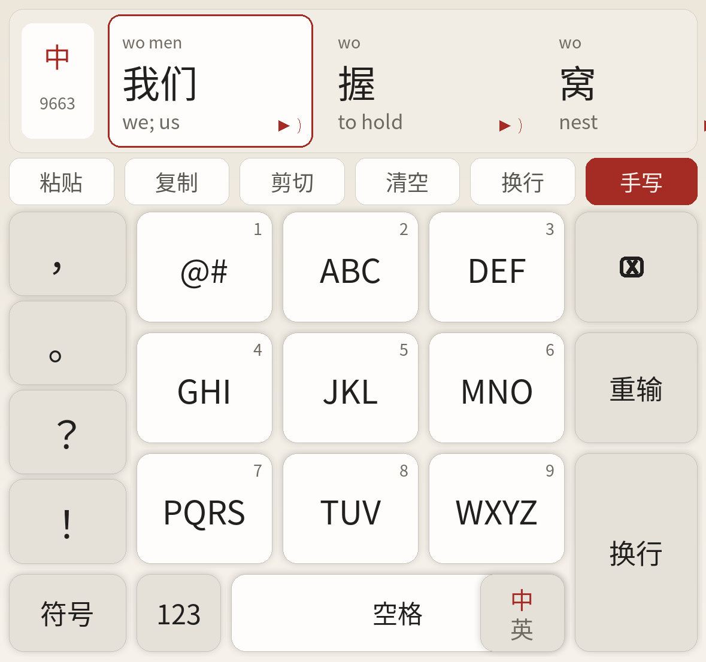

# InkKey · 水墨双语输入法（九宫格 + 26 键）

iPhone 上的中英双语输入法：中文用九宫格拼音，英文用 26 键 QWERTY；打字时候选栏上行中文、
下行英文对照，点哪行上哪行；每个候选都带小喇叭，点一下朗读英文并自动收进**生词本**。
中文打出整句时会在候选上方多一行「中文语句 → 英文翻译参考」，整句可直接上屏或朗读。
候选栏下面是一条常驻编辑栏：**粘贴 / 复制 / 剪切 / 清空 / 换行**，最右边一按就切到**手写中文**
（离线识别 6,708 个常用字，认出来的字同样进双语候选栏）。整体水墨风，支持换字体。

- 主 App `com.lin.inkkey`（SwiftUI，iOS 17+）：启用引导、生词本、设置
- 键盘扩展 `com.lin.inkkey.keyboard`：九宫格 / 26 键 / 手写键盘 + 双语候选栏 + 编辑栏
- App Group：`group.com.lin.inkkey`（设置、生词本、自定义字体、用户词频共享）

## 键盘布局

### 中文九宫格（默认）



```
，  [1 @#] [2 ABC] [3 DEF]        ⌫
。  [4 GHI] [5 JKL] [6 MNO]       重输
？  [7 PQRS][8 TUV][9 WXYZ]       换行/搜索/发送
！  [符号]  [123]   [ 空格 ]  [中/英] [🌐]
```

候选栏下面常驻一行编辑栏（所有模式都有）：

```
[粘贴] [复制] [剪切] [清空] [换行]               [✎ 手写]
```

### 英文 26 键（点 `中/英` 切换）

```
Q W E R T Y U I O P
 A S D F G H J K L
⇧  Z X C V B N M  ⌫
123  符号  [  空格  ]  中/英  换行/搜索  🌐
```

- 英文下点字母立刻上屏，同时把正在打的这个词送进候选栏：补全词 + 音标 + 中文释义，
  点候选会用整词替换掉半截单词，点释义行插入中文
- ⇧ 轻点＝下一个字母大写，双击＝大写锁定（键上出现「锁」）
- 退格：轻点删一格，按住连续删；重输：清空当前拼音/数字；`1 / @#` 符号页，`123` 数字页
- 回车键跟随宿主 App：搜索 / 发送 / 前往 / 完成 / 下一项 / 加入 / 路线 / 续写，默认「换行」
- 编辑栏的「换行」永远是换行：宿主把大回车键变成「搜索 / 发送」时，用它插一个干净的 `\n`
- 候选栏最右侧的 `⌄` 随时收起键盘（所有模式、所有页面都在）

## 编辑栏：复制 / 粘贴 / 剪切 / 清空

| 键 | 作用 |
| --- | --- |
| 粘贴 | 把剪贴板里的文字插到光标处，并在候选栏上方提示「已粘贴 N 字」 |
| 复制 | 有选中就复制选中；没有选中就复制光标前面这一行（最多 400 字） |
| 剪切 | 只对选中生效：复制后删掉选中部分，避免误删不该删的字 |
| 清空 | 扔掉正在拼的拼音（手写模式下清空整块手写板） |
| 换行 | 插入 `\n`，不受宿主「搜索 / 发送」影响 |

剪贴板需要「允许完全访问」；没开时点这些键只会在候选栏提示，不会静默失败。

## 手写中文（离线）

点编辑栏最右边的 `✎ 手写` 切到手写板：

```
┌──────────────────────────┐  [撤一笔]
│      米字格宣纸          │  [重写]
│      （手指写一个字）      │  [⌫ 退格]
│                          │  [空格]
└──────────────────────────┘  [换行]
```

- 每写完一笔（抬手）立刻识别，结果直接进双语候选栏：**汉字 + 拼音 + 英文释义 + 🔊**，
  点汉字上屏，点释义上屏英文，点 🔊 朗读并收进生词本
- 上屏后手写板自动清空，接着写下一个字
- 识别全在本地：`Resources/handwriting.bin`（948 KB，6,708 个常用字，笔画中位线重采样成
  每笔 6 个点）+ `HandwritingRecognizer`（笔画数 ±2 过滤 + 带跳步的 DTW 对齐，
  反向笔画也认）。实测一帧 0.7–8 ms，文件用 mmap 读，不建对象
- 写歪、写反笔顺、少一笔都有容错：候选栏一次给 12 个字，第一个通常就是要的字


## 双语候选栏

每个候选是一对：

| 模式 | 上行（点它上屏） | 下行（点它上屏） |
| --- | --- | --- |
| 中文 | 中文词（上方小字是拼音） | 英文释义（点它插入英文） |
| English | 英文词（上方小字是 IPA） | 中文释义（点它插入中文） |

行尾 🔊：朗读英文，并把这词写进生词本（App Group 共享）。

### 拼音音节条

九宫格按下数字时，候选栏下面会出现一排音节胶囊（`64` → ni / mi / nin / min…）：
点一个就把这个音节定下来，剩下的数字继续拼下一个音节，用来消歧同音字。
已锁定的音节显示在候选栏角标上（如 `ni 4`），点它旁边的 × 可以退回。

### 智能词组 / 整句

- 用词库里 41,148 条中文词的拼音做 Viterbi 分词：`96636` → 我们、`5468426` → 今天、
  `9694264` → 我 + 向(xiang)，多词组合会作为带「句」标记的候选排在最前面
- 用词库里出现过的词/短语会记住你的选择（App Group 用户词频），下次同样按键排名更靠前

### 整句翻译参考

当拼出的中文超过一个词时，候选区上方多出一行：`句 中文语句 → 英文参考 🌐 🔊`

- 点中文上屏中文，点英文上屏英文，点 🔊 朗读英文
- 翻译顺序：设置里填的自定义 OpenAI 兼容接口 → 内置公共接口
  （`translate.googleapis.com`，零 Key）→ 离线逐词释义（没有完全访问权限时也能用，永不空白）
- 只发送你正在组句的那段中文，300 ms 防抖 + 内存缓存；设置里可以整个关掉在线翻译

## 换字体

设置 → 键盘字体：

1. 内置四套：系统默认、水墨宋体、楷体手写、圆润黑体、等宽极客（按系统实际提供的字体自动回退）
2. 导入自定义字体：点「导入」选 `.ttf` / `.otf` / `.ttc`，文件复制进
   `App Group/Fonts/`，用 `CTFontManagerRegisterFontsForURL(..., .process, nil)`
   在主 App 与键盘扩展里同时注册，按键、候选词、双语对照行全部生效
3. 字体读不出来时自动退回系统字体，不会白屏或闪退

## 离线词库

`Resources/dictionary.tsv`（2.5 MB，UTF-8 一行一条，`v2<TAB>中文条数<TAB>英文条数` 开头）：

- 中文 **41,148 条**：4,931 个高频汉字 + 27,993 个双字词 + 4,850 个三字词 + 3,374 条四字成语/短语，
  带拼音、英文释义、词频（CC-CEDICT 释义 × jieba 词频，单字门槛 60、词组门槛 40）
- 英文 9,000 词：带 IPA、简明中文释义、频率排名
- T9 匹配：拼音/单词字母 → 数字序列前缀匹配；另建「声母首字母」索引，
  打 `96` 能出「我们」（w+m）；按「长度差 → 词频」排序，精确打满的优先
- 加载：直接扫原始字节建字符串（不走 JSONDecoder），40k+ 条 **约 60–110 ms**，
  词表用 `[Int32]` 索引而不是复制整条词条，键盘扩展稳定在 20 MB 上下
- 手写模板 `Resources/handwriting.bin`（948 KB）：见上一节

数据来源（构建时脚本 `Tools/build_dictionary.py` 生成，运行时不联网）：

| 数据 | 来源 | 许可 |
| --- | --- | --- |
| 中英词条与拼音 | [CC-CEDICT](https://www.mdbg.net/chinese/dictionary?page=cc-cedict) | CC BY-SA 4.0 |
| 中文词频 | [jieba](https://github.com/fxsjy/jieba) `dict.txt` | MIT |
| 英文词表 | [google-10000-english](https://github.com/first20hours/google-10000-english) | Apache-2.0 |
| 英式/美式音标 | [ipa-dict](https://github.com/open-dict-data/ipa-dict) | MIT |
| 英中释义 | [ECDICT](https://github.com/skywind3000/ECDICT) | MIT |
| 手写笔顺模板 | [Make Me a Hanzi](https://github.com/skishore/makemeahanzi) `graphics.txt` | LGPL / Arphic |

重新生成：

```sh
sh Tools/fetch_data.sh          # 下载原始数据到 Tools/_data（约 110 MB，不进仓库）
python3 Tools/build_dictionary.py     # -> Resources/dictionary.tsv
python3 Tools/build_handwriting.py   # -> Resources/handwriting.bin
python3 Tools/make_icon.py           # 重新画 1024 AppIcon
python3 Tools/verify_project.py      # 构建前自检
```

## 构建

```sh
brew install xcodegen
xcodegen generate
open InkKey.xcodeproj
```

或直接用 GitHub Actions（未签名 IPA，产物在 Release）：

1. 打开 `docs/build-ipa.yml` 复制全文
2. 在网页新建 `.github/workflows/build-ipa.yml` 粘贴提交：
   <https://github.com/Lin00700/InkKey/new/main?filename=.github/workflows/build-ipa.yml>
   （仓库里的 `.github/workflows/` 通过 `.git/info/exclude` 排除，避免推送被 workflows 权限挡住）
3. push 触发的 macOS runner 偶尔排队超时，失败就到 Actions 页 `Run workflow` 手动重跑

## 安装与启用

1. 用 全能签 / AltStore / SideStore 等自签安装 `InkKey-unsigned.ipa`
2. **重签时勾上 App Group `group.com.lin.inkkey`**，否则键盘读不到主 App 的设置
3. 设置 → 通用 → 键盘 → 键盘 → 添加新键盘 → InkKey
4. 点开 InkKey → 打开「允许完全访问」（发音、生词本、字体共享、自定义字体读取都需要）
5. 任意输入框长按地球键切到 InkKey

## 版本

`MARKETING_VERSION 1.0.0` / `CURRENT_PROJECT_VERSION 1`，主 App 与扩展的 `project.yml`
里都显式设置，避免全能签重签时报「版本号缺失」。
